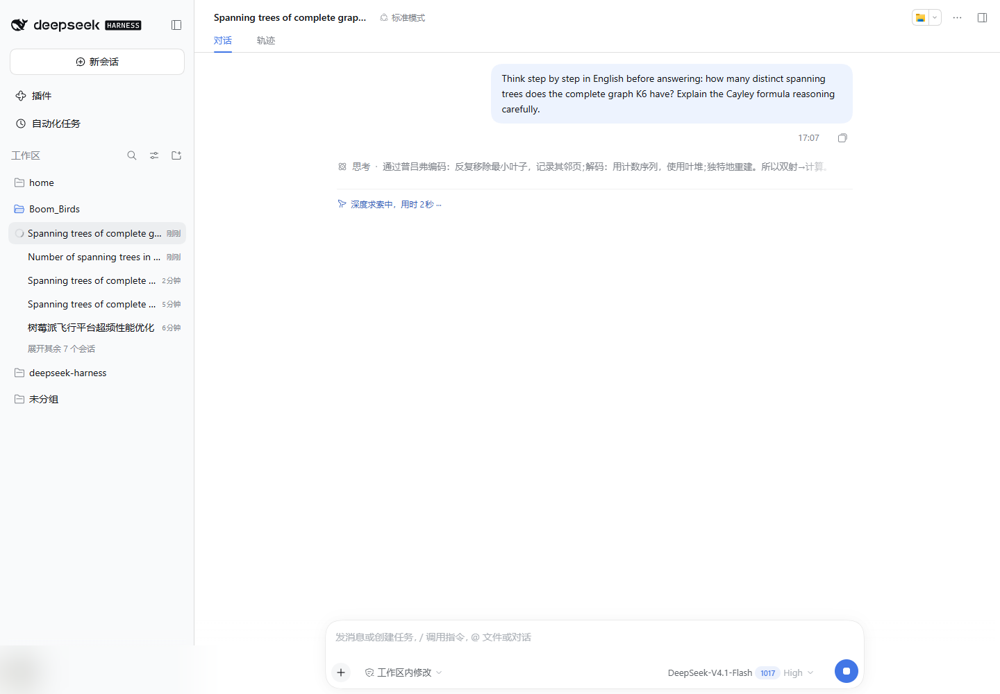
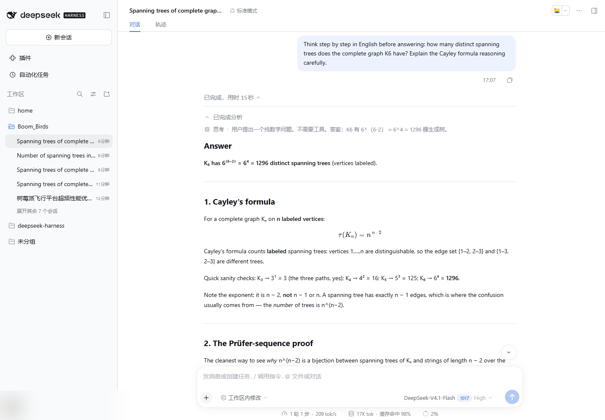
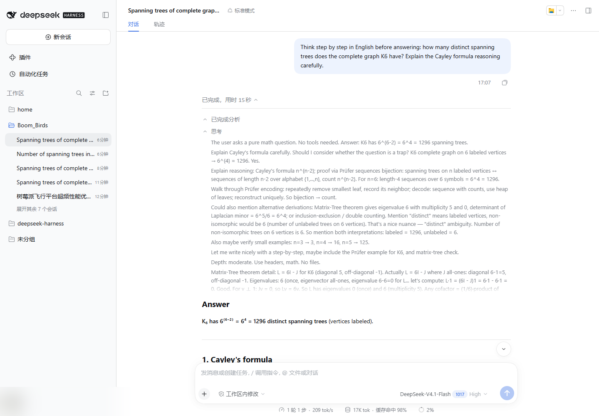

# dsh-thinking-zh · 思考过程折叠预览中文翻译

一个给 [DeepSeek Harness](https://github.com/deepseek-ai) Web 界面用的插件：把对话里**折叠状态的英文思考预览**自动换成中文。

DSH 默认把模型的思考过程折叠成一行预览。展开后 DSH 内置的 `cot-translation` 插件可以翻译正文，但折叠时那一行预览始终是英文原文——而日常浏览时，我们看到的恰恰是这一行。本插件补的就是这一行，不改变任何其它行为。

## 为什么需要它

| 位置 | 由谁负责 |
| --- | --- |
| 折叠思考行的一行预览 | **本插件**（自动应用，无需操作） |
| 展开后的思考正文 | DSH 内置 `@deepseek-ai/dsh-experimental-cot-translation-bundle`（手动切换原文/译文） |

- 内置插件在其 README 中明确说明「折叠的预览保留原文」，它的作用范围只有展开后的正文。
- 本插件用 `:not([data-expanded])` 只处理折叠行；一旦展开，立刻让位给内置插件，两者可以同时启用、互不冲突。
- 即使没有安装内置 `cot-translation` 也能独立工作；此时展开后的正文保持英文原文。

原文不会丢：被替换的文本节点保留 `title` 属性和 `data-dsh-thinking-zh-original`，鼠标悬停即可看到英文原句。

## 效果

流式输出期间，折叠的「思考」行已经是中文，正文仍在继续输出：



回复结束后展开「已完成」过程组，折叠思考行仍显示中文预览：



展开同一行，思考正文仍是完整英文原文——内置行为未被破坏：



更多截图（热重载恢复、上游故障降级与恢复、切换会话等）在 [`test/evidence/`](test/evidence/)，验证报告见 [`test/REPORT-final.md`](test/REPORT-final.md) 与 [`test/REPORT-client.md`](test/REPORT-client.md)。

## 工作原理

### 宿主半 / 浏览器半

DSH 桌面端每次启动都会在随机的 loopback 端口上提供 Web 界面，浏览器直接调用第三方翻译接口会遇到 CORS 与 opaque origin 问题。插件因此分成两半：

- **宿主半**（`src/index.js`，Node/ESM）：在 DSH 的 Web 同源上注册 4 个路由，把翻译请求代理到匿名翻译端点，负责去重、批量、缓存、超时与限流。
- **浏览器半**（`src/client.js`，普通浏览器脚本）：用 `MutationObserver` 观察对话流，合并到每个动画帧一次扫描；找到 `[data-variant="think"][data-preview]:not([data-expanded])` 行里 `[data-shimmer-decoration] + span` 的预览文本；等到该字符串 **400ms 内不再变化**后，批量（每批 ≤ 8 段）POST 给宿主半；拿到中文后**只修改文本节点的内容**并写入几个诊断属性，不插入/删除元素、不改 `innerHTML`、不碰 React 状态。

稳定性计时是**按字符串**而不是按页面：回答正文持续流式输出时，页面一直在 mutation，页面级防抖会被无限重置；按字符串计时后，预览该翻就翻。

浏览器半还会在预览出现时**提前预取**（prefetch）翻译，把网络耗时挪到 400ms 稳定窗口里，因此稳定的瞬间几乎立刻变成中文。

### 翻译后端

| provider | 端点 | 说明 |
| --- | --- | --- |
| `bing`（默认） | `POST https://edge.microsoft.com/translate/translatetext?to=zh-Hans&isEnterpriseClient=false` | 免费、无需 key；与 DSH 内置思考翻译相同的基础设施 |
| `google` | `POST https://translate.googleapis.com/translate_a/single` | 代码保留，可通过 `/set` 切换；匿名调用常被 429，因此不默认 |

- 请求体是 JSON 字符串数组，响应按输入顺序返回译文。
- 超时 10 秒；失败时**逐段降级**为 `{ "text": null, "error": "..." }`，页面保留英文原文，不会抛异常、不会自动切换 provider。

### 缓存

- 内存缓存（Map，删除再插入实现 LRU 语义）+ 磁盘缓存 `$DSH_HOME/dsh-thinking-zh/cache.json`。
- 键为 `sha256(provider + targetLanguage + 原文)`，值为中文译文；因此**磁盘上不保存英文原句**，同一句话跨页面、跨重启都只请求一次。
- 最多保留 5000 条，超出淘汰最旧的；写盘前防抖 2 秒，采用「临时文件 + rename」原子替换。
- 浏览器侧另有一份上限 400 条的内存映射：React 重渲染覆盖文本后，观察器会从内存直接写回中文，**零网络请求**。

### 目标语言

- 默认 `zh-Hans`。
- 传给 Bing 前会归一化：`zh` / `zh-cn` / `zh-sg` / `zh-hans` → `zh-Hans`；`zh-tw` / `zh-hk` / `zh-mo` / `zh-hant` → `zh-Hant`；其它标签按小写原样传递。

### 安全限制

四个路由都只接受本机来源：

- TCP 对端必须是 loopback（`127.0.0.0/8`、`::1`、`::ffff:127.x`）；
- `Host` 必须精确是 `localhost`、IPv6 `::1` 或真正的 127.x 点分四段地址——`127.0.0.1.nip.io` 这类「解析到 loopback 的名字」会被拒绝，以防 DNS rebinding；
- 请求带 `Origin` 时必须与 `Host` 同源；不带 `Origin` 的非浏览器请求放行；
- 响应不带任何 CORS 放行头；
- 请求体上限 256KB、单次最多 8 段、每段最多 4000 字符；`/diag` 的 payload ≤ 512KB，文件名会被净化，目录最多保留 60 个文件。

## 安装

前置条件：Windows 上的 DSH 桌面版（Web 界面可用）；不需要安装任何 npm 依赖（本插件零运行时依赖）。构建和测试需要 Node.js ≥ 20，也可以用 DSH 自带的 Node 运行时。

1. 把仓库放到 `$DSH_HOME/plugins`（`$DSH_HOME` 默认是 `$env:USERPROFILE\.dsh`）：

   ```powershell
   $dshHome = if ($env:DSH_HOME) { $env:DSH_HOME } else { Join-Path $env:USERPROFILE ".dsh" }
   $plugin  = Join-Path $dshHome "plugins\dsh-thinking-zh"
   git clone https://github.com/waterc07/dsh-thinking-zh.git $plugin
   ```

2. 运行安装脚本（幂等，重复执行只补缺失项）：

   ```powershell
   $node = "node"   # PATH 里没有 Node 时，改成 DSH 安装目录下的 resources\runtime\bin\node.cmd
   # 先 dry-run 看一眼会改什么
   & $node (Join-Path $plugin "scripts\install.mjs") --profile desktop --dry-run
   # 正式安装
   & $node (Join-Path $plugin "scripts\install.mjs") --profile desktop
   ```

   其中 `$node` 是 `node` 命令；如果 PATH 里没有 Node，用 DSH 安装目录下的 `resources\runtime\bin\node.cmd`。`--profile` 默认就是 `desktop`，使用别的档案名时改成对应值。

3. **重启 DSH**。档案只在启动时读取；浏览器半的热更新依赖 `pnpm run dev:web` 的 watcher，正常安装后请直接重启应用。

安装脚本做三件事（首次修改 `package.json` 前会自动备份为 `package.json.bak-dsh-thinking-zh-<时间戳>`）：

1. 在 profile 的 `package.json` 中写入 `"dsh-thinking-zh": "link:../../plugins/dsh-thinking-zh"`；
2. 把 `dsh-thinking-zh` 追加到 `dsh.profile.bundles`（最高优先级层）；
3. 创建 `node_modules\dsh-thinking-zh` junction，使 profile 无需重新 `pnpm install` 也能解析到插件。

卸载：

```powershell
$node = "node"   # 同上；或 DSH 自带的 node.cmd
& $node (Join-Path $plugin "scripts\install.mjs") --profile desktop --uninstall
# 然后重启 DSH
```

> `install.mjs` 使用 Windows 的 `mklink /J` 创建 junction，因此仅支持 Windows。其它平台可以手动把插件路径加入 profile 的依赖与 `dsh.profile.bundles`。

## 使用与配置

默认开箱即用，不需要任何配置。插件没有独立 UI，配置通过 Web 同源上的 HTTP 路由完成（DevTools Console、`Invoke-RestMethod`、`curl` 均可）。端口就是当前 DSH Web 界面的端口：桌面端是启动时随机分配的 loopback 端口，用 `dsh web --port` 启动时则是你指定的端口。

查看当前状态：

```powershell
$port = 5599   # 换成你的 DSH Web 端口；桌面端可在界面地址栏看到
Invoke-RestMethod "http://127.0.0.1:$port/api/dsh-thinking-zh/state"
```

修改配置：

```powershell
$body = @{ enabled = $true; targetLanguage = "zh-Hans"; provider = "bing" } | ConvertTo-Json
Invoke-RestMethod -Method Post -Uri "http://127.0.0.1:$port/api/dsh-thinking-zh/set" `
  -ContentType "application/json" -Body $body
```

可写字段（都是可选的，省略则保持原值）：

| 字段 | 类型 | 说明 |
| --- | --- | --- |
| `enabled` | boolean | `false` 时停止翻译，并把页面上已翻译的预览恢复成英文 |
| `targetLanguage` | string | 目标语言，默认 `zh-Hans`；可用 `zh-Hant` 等，见上文归一化规则 |
| `provider` | `"bing"` / `"google"` | 翻译后端，默认 `bing`；其它值被忽略 |

配置持久化在 `$DSH_HOME/dsh-thinking-zh/state.json`。浏览器半每 20 秒轮询一次状态，因此通过 `/set` 修改后最长约 20 秒生效。

页面内调试接口（浏览器 Console）：

```js
window.__dshThinkingZh.status()   // enabled / targetLanguage / 本轮统计
window.__dshThinkingZh.rows()     // 每个思考行的判定结果与跳过原因
window.__dshThinkingZh.events()   // 最近 120 条内部事件
await window.__dshThinkingZh.diag('manual')  // 把 DOM 快照写入 diag 目录
```

## HTTP 路由表

所有路由仅限 loopback + 同源，方法不匹配返回 `405`，来源不合法返回 `403`。

| 方法 | 路径 | 请求体 | 响应 |
| --- | --- | --- | --- |
| GET | `/api/dsh-thinking-zh/state` | — | `{ "enabled": true, "targetLanguage": "zh-Hans", "provider": "bing", "rev": 1730000000000 }` |
| POST | `/api/dsh-thinking-zh/translate` | `{ "segments": [{ "id": "s1", "text": "..." }], "targetLanguage"?: "..." }` | `{ "results": [{ "id": "s1", "text": "…", "cached": false }], "provider": "bing", "targetLanguage": "zh-Hans" }` |
| POST | `/api/dsh-thinking-zh/set` | `{ "enabled"?: boolean, "targetLanguage"?: string, "provider"?: "bing"\|"google" }` | 与 `GET /state` 相同 |
| POST | `/api/dsh-thinking-zh/diag` | `{ "name": "preview-dom", "payload": { ... } }` | `{ "ok": true, "path": "…\\dsh-thinking-zh\\diag\\preview-dom.json" }` |

- `translate`：单次最多 8 段、每段最多 4000 字符；空字符串直接返回 `{ text: "", cached: true }`，不发起网络请求。单段失败不影响整批，该段返回 `text: null` 与 `error`。
- `diag`：把浏览器侧的 DOM 结构落盘到 `$DSH_HOME/dsh-thinking-zh/diag/`，用于在没有 DevTools 的情况下排查选择器漂移；文件名为净化后的 `<name>.json`，最多保留 60 个。
- 所有响应均带 `cache-control: no-store` 与 `referrer-policy: no-referrer`。

## 目录结构

```text
dsh-thinking-zh/
├─ src/
│  ├─ index.js          # 宿主半：路由、翻译、缓存、安全守卫
│  └─ client.js         # 浏览器半：DOM 观察、稳定性判定、就地替换
├─ lib/                 # 构建产物（src/*.js 的直接拷贝，随仓库提交）
├─ scripts/
│  ├─ build.mjs         # src -> lib，无打包器
│  └─ install.mjs       # 写入 profile、创建 junction、支持 --dry-run/--uninstall
├─ test/
│  ├─ host-functional.test.mjs
│  ├─ host-security.test.mjs
│  ├─ lib/              # 测试脚手架与历史 Playwright 片段
│  ├─ evidence/         # 截图与结构化测试证据
│  ├─ CONTRACT.md       # 宿主 ↔ 浏览器半接口契约
│  ├─ REPORT-*.md       # 验证报告
│  └─ README.md         # 测试说明
├─ cordis.patch.yml     # bundle patch：把插件插入 profile 的层栈
├─ package.json
├─ LICENSE
└─ README.md
```

## 开发与构建

`src/*.js` 是唯一源文件，`lib/*.js` 是构建产物：没有打包器、没有转译，`scripts/build.mjs` 只是把 `src/` 下的 `.js` 复制到 `lib/`。

```powershell
node scripts/build.mjs   # 输出：dsh-thinking-zh: built 2 file(s) — ...
```

改完 `src/` 后必须重新构建，否则 DSH 加载的仍是旧的 `lib/`。`lib/` 必须随仓库提交（`package.json` 的 `main`/`exports`/`files` 都指向它）。

加载契约（改动时不要破坏）：

- 宿主半：ESM 导出 `name`、`inject = ['webServer']`、`makeRoutes()` 与 `apply(ctx)`；`apply` 在 `ctx.effect` 内注册路由，并在卸载时释放。
- 浏览器半：通过 `window.__ModuleLoader__.load({ id: 'dsh-thinking-zh', factory })` 发布，导出 `apply(ctx)` 与 `inject = []`；`apply` 会先回收上一个实例，便于热重载。
- `cordis.patch.yml` 把 `dsh-thinking-zh` 作为最高优先级 bundle 层插入 profile。

## 测试

宿主半有可离线复跑的自动化测试（自定义 runner，在真实 `node:http` 服务器上跑真实路由）：

```powershell
node test/host-functional.test.mjs
node test/host-security.test.mjs

# 没有网络时跳过唯一一个访问真实翻译端点的用例（记为 NOTE，不算 PASS）
$env:DSH_THINKING_ZH_OFFLINE = "1"
node test/host-functional.test.mjs
```

- `host-functional`：翻译、缓存命中、批处理与去重、8 段/4000 字符边界、超时与上游 500 的逐段降级、`enabled=false` 短路、缓存持久化与 5000 条淘汰、原子写、`/state`、`/set`、`/diag`、`apply()` 生命周期。
- `host-security`：loopback + Host + Origin 信任矩阵（含 `127.0.0.1.nip.io` 等 DNS rebinding 形态）、`/diag` 路径穿越、SSRF、body 上限、无 CORS 放行。
- 浏览器半依赖运行中的 DSH 界面、Playwright 与真实模型输出，没有可离线复跑的自动化测试；其行为证据是 `test/evidence/` 下的截图与 JSON，以及 [`test/REPORT-client.md`](test/REPORT-client.md)。
- 详细说明见 [`test/README.md`](test/README.md)。

## 已知限制

- **范围**：只翻译折叠预览；展开后的正文由 DSH 内置 `cot-translation` 负责。两者可能不同步（内置插件默认显示译文视图）。
- **延迟**：热路径约 0.4 秒（400ms 稳定性门槛）；首次打开页面时代理会先发一次极小的预热请求，避免首条预览多付约 0.9 秒的 TLS 握手。
- **流式末尾**：思考文本仍在变化时不会翻译，最后几个字可能短暂保持英文，稳定后才会替换。
- **翻译质量**：匿名机器翻译，术语可能走样（例如把 `asar` 音译、把普通名词译得生硬）。
- **可用性**：匿名端点没有 SLA；失败时保留英文，同一字符串 60 秒内不重试，也不会自动切换 provider。缓存命中时完全离线可用。
- **配置生效**：`/set` 依赖浏览器半的 20 秒轮询，`enabled=false` 的恢复同理。
- **DOM 契约**：选择器依赖 DSH 渲染出的 `data-variant="think"` / `data-preview` / `data-expanded` / `data-shimmer-decoration` 等语义属性；上游若改变这些属性，需要更新选择器。`/diag` 能把真实 DOM 结构落盘，便于快速修复。
- **跳过规则**：过短（< 6 字符）、纯数字/符号、已是中文、URL、命令行、路径或单个标识符等文本不会发送翻译；因此像 `Inspecting` 这样的单英文词也可能被跳过。这是为避免翻译 URL/命令/路径做的保守取舍。
- **平台**：安装脚本使用 Windows junction（`mklink /J`），仅支持 Windows；其它平台需手动安装。
- **多页面**：同一天打开多个页面会各自观察 DOM，但磁盘缓存保证同一句话只请求一次。

## 隐私

翻译会把预览文本发送给 Microsoft Edge 的匿名翻译端点（与 DSH 内置思考翻译的默认行为一致）。本地只持久化 `sha256` 键与中文译文，英文原句不写入磁盘；缓存与配置保存在 `$DSH_HOME/dsh-thinking-zh/`。若不希望外发，可设置 `enabled: false`。

## 许可

[MIT](LICENSE) © 2026 waterc
